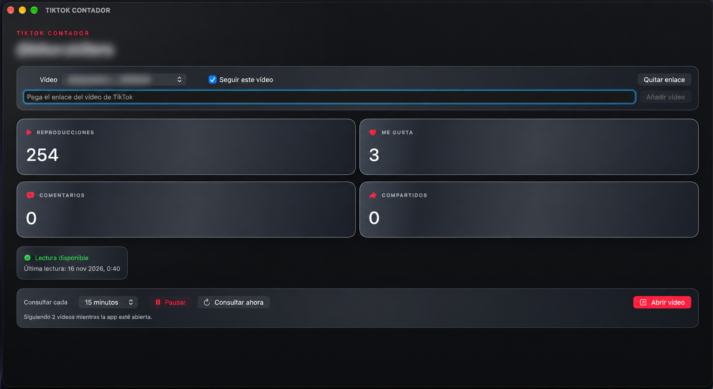
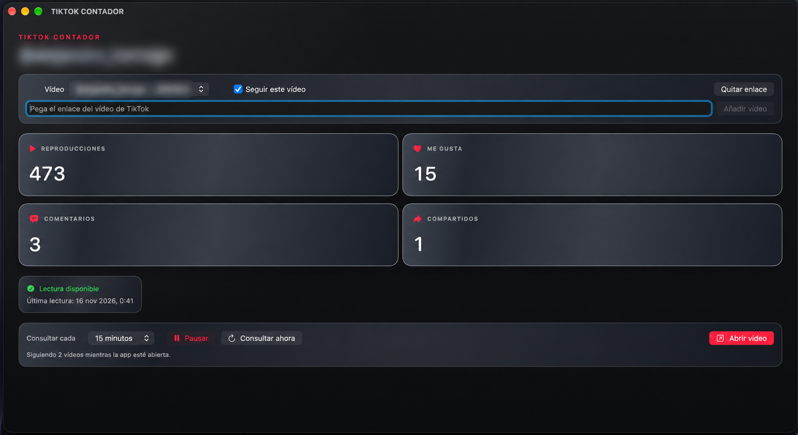
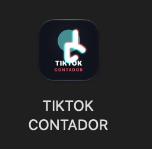

# TikTok Contador

App de macOS para consultar las reproducciones, los me gusta, los comentarios y las veces que se ha compartido un vídeo público de TikTok. Puedes guardar varios enlaces, actualizar a mano o activar el seguimiento cada 15, 30 o 60 minutos mientras la app esté abierta.

## Capturas







## Instalación

Necesitas macOS 14 o posterior y las herramientas de línea de comandos de Xcode. Si aún no las tienes, ejecuta `xcode-select --install`.

1. Descarga [tiktok-cli 0.2.1](https://github.com/tamnd/tiktok-cli/releases/tag/v0.2.1). Elige el archivo `darwin_arm64` para Apple Silicon o `darwin_amd64` para Intel y descomprímelo.
2. Desde la carpeta que contiene el ejecutable `tt`, cópialo a la ubicación que usa la app.

   ```bash
   mkdir -p "$HOME/Library/Application Support/TikTok Contador"
   install -m 755 tt "$HOME/Library/Application Support/TikTok Contador/tt"
   ```

3. Descarga o clona este repositorio. Desde su carpeta, compila y abre la app.

   ```bash
   ./build.sh
   open "dist/TikTok Contador.app"
   ```

## Uso

Pega el enlace completo de un vídeo público, con el formato `https://www.tiktok.com/@usuario/video/ID`. Selecciona el vídeo para ver sus cifras o activa el seguimiento de los vídeos que quieras actualizar periódicamente.

La lista y el último recuento disponible se guardan en tu Mac. Si TikTok limita una consulta o el vídeo deja de estar disponible, la app conserva la última lectura y muestra el error. La consulta depende de [tiktok-cli](https://github.com/tamnd/tiktok-cli), un proyecto independiente.
